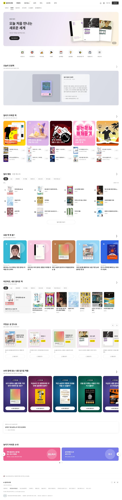
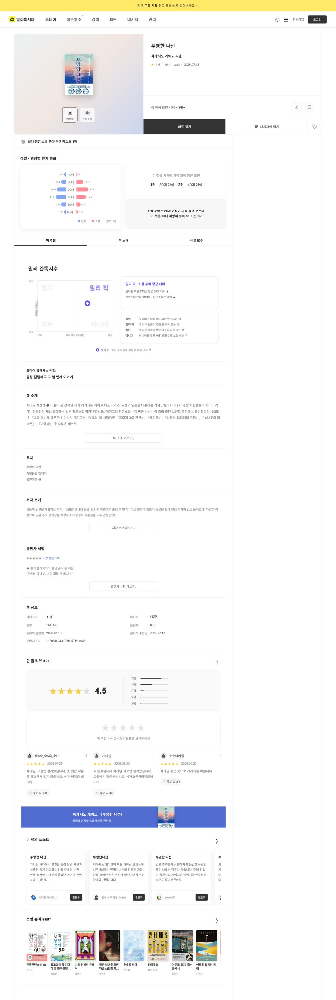
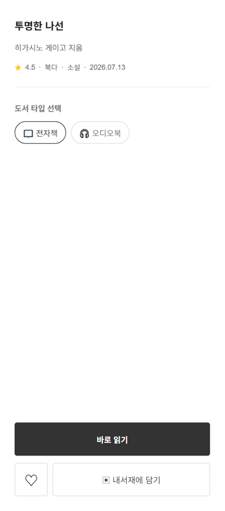

# 밀리의서재 클론 — 현정현


> 도서 구독 서비스 밀리의서재의 메인 · 상세 페이지를 HTML · CSS · JavaScript로 따라 만든 퍼블리싱 연습 프로젝트

<table>
  <tr><th align="left" width="130">기간</th><td>2026.08</td></tr>
  <tr><th align="left">형태</th><td>개인 프로젝트 · 클론 코딩</td></tr>
  <tr><th align="left">역할</th><td>기획 · 퍼블리싱 · 기능 구현 (1인)</td></tr>
  <tr><th align="left">기술</th><td>HTML · CSS · JavaScript · 카카오 책 검색 API · GitHub Pages</td></tr>
  <tr><th align="left">링크</th><td><a href="https://haru40.github.io/Book_Site/">사이트 바로가기 ↗</a></td></tr>
</table>

---

## 목차

<table>
  <tr><th align="left" width="90">화면</th><td><a href="#s1">1. 메인 페이지</a> · <a href="#s2">2. 상세 페이지</a></td></tr>
  <tr><th align="left">구현</th><td><a href="#s3">3. 주요 기능</a> · <a href="#s4">4. 책 데이터 연동</a></td></tr>
  <tr><th align="left">구조</th><td><a href="#s5">5. 프로젝트 구조</a></td></tr>
</table>

---

<a name="s1"></a>

## 1. 메인 페이지

<table>
  <tr>
    <td width="45%" valign="top"></td>
    <td valign="top">

**11개 섹션으로 구성한 홈 화면**

| 섹션 | 내용 |
|---|---|
| 추천 슬라이드 | 4초 자동 전환 · 좌우 버튼 · 페이지 표시 |
| 퀵 메뉴 | 카테고리 아이콘 메뉴 |
| 오늘의 인생책 | 회원 추천 책 카드 |
| 밀리가 주목한 책 | 주제별 배너 + 책 목록 |
| 밀리 랭킹 | 분야 탭 · 1~12위 목록 |
| 요즘 책 뭐 봄? | 에디터 추천 카드 |
| 따끈따끈, 새로 들어온 책 | 분야 탭 · 신간 목록 |
| 커밍순 | 공개 예정 도서 슬라이드 |
| AI와 함께 읽는 책 | 주제별 책 카드 슬라이드 |
| 오리지널 | 밀리 오리지널 콘텐츠 |
| 이벤트 | 배너 6개 · 한 화면 2개 · 자동 슬라이드 + 점 이동 |

</td>
  </tr>
</table>

---

<a name="s2"></a>

## 2. 상세 페이지

<table>
  <tr>
    <td width="45%" valign="top"></td>
    <td valign="top">

**책을 누르면 그 책의 상세 페이지로 이동**

- 책 표지 · 제목 · 저자 · 별점 · 출간일 — 카카오 책 검색 API 결과로 채움
- 성별 · 연령별 인기 분포, 밀리 완독지수
- 책 소개 · 목차 · 저자 소개 · 출판사 서평 · 책 정보
- 한 줄 리뷰 목록
- 소설 분야 BEST
- 탭(책 추천 · 책 소개 · 리뷰)을 누르면 해당 위치로 스크롤

**스크롤하면 오른쪽에 따라오는 책 정보**



본문이 시작되는 위치를 지나면 오른쪽에 책 정보 · 바로 읽기 · 내서재에 담기 카드가 나타나고 화면에 고정

</td>
  </tr>
</table>

---

<a name="s3"></a>

## 3. 주요 기능

| 기능 | 구현 |
|---|---|
| 히어로 슬라이드 | 4초 자동 전환, 버튼을 누르면 자동 타이머 다시 시작 |
| 이벤트 슬라이드 | 카드 수 ÷ 한 화면 카드 수로 페이지 계산, 점 클릭 이동 |
| 랭킹 · 신간 탭 | 분야 탭을 누르면 해당 분야 책 목록으로 교체 |
| 상세 이동 | 책 요소의 `data-book-title`을 읽어 `detail.html?title=책제목`으로 이동 |
| 상세 데이터 | URL의 책 제목으로 다시 검색해 표지 · 정보 표시 |
| 따라오는 책 정보 | 스크롤 위치가 본문 시작 지점을 지나면 `show` 클래스로 카드 표시 |
| 공통 헤더 · 푸터 | `components/` 의 HTML 조각을 두 페이지에서 함께 사용 |

---

<a name="s4"></a>

## 4. 책 데이터 연동

- **카카오 책 검색 API**로 실제 책 정보(표지 · 제목 · 저자 · 출판사 · 가격)를 불러와 화면에 표시
- 검색 함수 하나(`searchBooks`)를 만들어 메인 · 상세 페이지 전체에서 재사용
  - 키워드 · 개수 · 정렬 · 제목 검색 여부를 인자로 받음
- 판매가가 없으면 정가로 대체, 책 개수에 따라 카드 크기 조절

---

<a name="s5"></a>

## 5. 프로젝트 구조

```
Book_Site/
├── index.html        메인 페이지 (11개 섹션)
├── detail.html       책 상세 페이지
├── components/
│   ├── header.html   공통 헤더
│   └── footer.html   공통 푸터
├── css/
│   ├── common.css    공통 스타일
│   ├── style.css     메인 페이지
│   └── detail.css    상세 페이지
├── js/
│   ├── api.js        카카오 책 검색 공통 함수
│   ├── common.js     헤더 · 푸터 불러오기
│   ├── main.js       메인 슬라이드 · 탭 · 책 목록
│   └── detail.js     상세 데이터 · 리뷰 · 따라오는 책 정보
└── img/              배너 · 로고 · 미리보기 이미지
```

---

<sub>밀리의서재 화면을 참고한 학습용 클론 프로젝트 · 상업적 목적 없음</sub>
